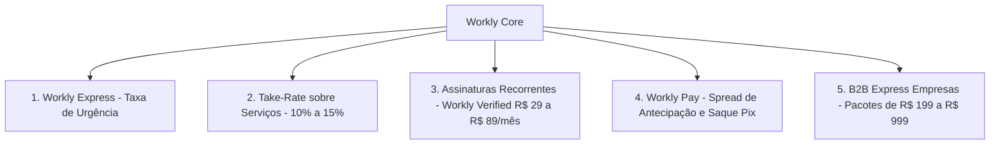

# PLANO DE NEGÓCIOS & ESTRATÉGIA DE ESCALA
## Workly — O SuperApp do Trabalho que Conecta
**Data:** 10 de Outubro de 2026  
**Versão:** 1.0 (Estratégia & Arquitetura)  
**Projeto:** Workly Brasil  
**Localização:** `/Users/lucasvinicius/projetos/APLICAÇÕES/maikdouglas`  

---

## 1. SUMÁRIO EXECUTIVO

O **Workly** nasce para suprir uma lacuna crítica no mercado de trabalho e prestação de serviços no Brasil: a enorme distância de confiança e agilidade entre quem precisa de um serviço imediato e quem tem a habilidade para executá-lo.

Diferente de plataformas obsoletas (como GetNinjas, que cobram créditos apenas para o profissional visualizar contatos sem garantia de fechamento), o Workly opera como um **Marketplace de Dois Lados com Fintech e Reputação Embutidas**, onde a geração de valor real dita a monetização.

---

## 2. A RESOLUÇÃO DOS 3 GRANDES DILEMAS DE MARKETPLACE

### 2.1. O Fim da Desintermediação (Como impedir a fuga para o WhatsApp)
A maior ameaça de qualquer plataforma de serviços no Brasil é o cliente e o profissional fecharem o primeiro serviço no app e combinarem os próximos diretamente no WhatsApp para evitar taxas.

**A Solução Proprietária do Workly:**
1. **Custódia Segura (Escrow / Workly Garantia):**
   - O contratante paga via PIX no momento da contratação. O valor fica retido na custódia do Workly.
   - O dinheiro **só é liberado para o prestador quando o cliente confirma a conclusão do serviço**.
   - *Por que o cliente não foge pro WhatsApp?* Porque se pagar por fora e o prestador sumir ou quebrar algo, o cliente toma o prejuízo sozinho. Pelo Workly, ele tem **Garantia de Devolução Integral**.
2. **O Workly Score como Ativo Financeiro do Trabalhador:**
   - Cada serviço concluído e pago **dentro da plataforma** adiciona pontos no score do profissional, elevando seu ranking até o nível *Diamante*.
   - Prestadores de nível alto recebem **5x a 10x mais pedidos automáticos**.
   - Se o prestador fechar por fora, ele não ganha pontuação, seu perfil perde relevância no ranking de buscas e ele deixa de receber chamadas do *Workly Express*.

---

### 2.2. A Solução do "Ovo ou a Galinha" (Cold Start & Liquidez Inicial)
Marketplaces que tentam abrir no Brasil inteiro sem densidade local morrem sem liquidez.

**Estratégia de Lançamento Hiperlocal em 3 Fases:**
* **Fase 1: O Monopólio Hiperlocal (Praça Piloto):**
  - Escolha de uma única praça-piloto com forte atividade econômica (ex.: Região Metropolitana de Goiânia ou Rio Verde / SP).
  - Foco em **apenas 2 verticais prioritárias de alta frequência**:
    1. *Eventos & Gastronomia:* Garçons, recepcionistas, churrasqueiros, bartenders e seguranças.
    2. *Manutenção Residencial Urgente:* Eletricistas, encanadores, desentupidores e chaveiros.
* **Fase 2: Semeadura da Oferta (Seed the Supply):**
  - Cadastramento ativo e validação gratuita dos primeiros 200 prestadores locais selecionados a dedo.
  - Concessão de **Selo Verificado Grátis por 90 dias** e bônus de ativação de R$ 30 na carteira Workly para os pioneiros.
* **Fase 3: Disparo da Demanda (Express B2B):**
  - Apresentação do **Workly Express para Empresas** (buffets, restaurantes, construtoras, condomínios) com garantia: *"Seu profissional confirmado em até 30 minutos ou você não paga nada"*.

---

### 2.3. Seguro de Serviço & Resolução de Disputas
* **Fundo de Proteção Workly:** 1,5% de cada transação é destinado a um fundo mútuo de contingência.
* Em caso de avaria ou serviço incompleto: mediação em até 4 horas com reembolso ou envio imediato de um profissional substituto nível Diamante sem custo adicional para o cliente.

---

## 3. MODELO DE MONETIZAÇÃO & UNIT ECONOMICS

O Workly opera com 5 fluxos de receita complementares:

### Projeção de Unit Economics (Exemplo por Transação Média de R$ 250):
* Valor médio do serviço prestado: **R$ 250,00**
* Take-Rate da plataforma (12%): **R$ 30,00**
* Custo de processamento Pix (Gateway): **- R$ 0,80**
* Provisão para Fundo de Garantia (1,5%): **- R$ 3,75**
* **Margem Bruta por Transação:** **R$ 25,45 (84,8% da receita líquida)**

---

## 4. O SISTEMA WORKLY SCORE (A Lógica do Algoritmo)

O algoritmo de reputação é calculado dinamicamente de 0 a 1.000 pontos:

$$\text{Workly Score} = (P \times 0.35) + (Q \times 0.35) + (V \times 0.20) + (C \times 0.10)$$

* **$P$ (Pontualidade):** Taxa de chegada e início no horário agendado (0 a 1.000).
* **$Q$ (Qualidade / Avaliação do Cliente):** Média ponderada de estrelas e comentários verificados.
* **$V$ (Volume de Serviços Concluídos):** Quantidade de trabalhos entregues sem cancelamento.
* **$C$ (Capacitação Workly Academy):** Cursos e certificações concluídos dentro do app.

### Faixas de Nível:
* **Bronze (0 – 399):** Novo profissional, comissão padrão (15%).
* **Prata (400 – 699):** Profissional com histórico positivo comprovado.
* **Ouro (700 – 899):** Destaque nas buscas, comissão reduzida (12%).
* **Diamante (900 – 1.000):** Prioridade absoluta no *Workly Express*, selo especial, taxa mínima (8%) e garantia de alta demanda diária.

---

## 5. ESTRATÉGIA GO-TO-MARKET (GTM)

1. **Parcerias Estratégicas Locais:**
   - Parcerias com sindicatos, associações comerciais, cursos profissionalizantes e grupos regionais de autônomos.
2. **Campanhas de Tráfego Pago Hiperlocal (Raio de 5 a 10 km):**
   - Anúncios no Meta/Instagram e Google Search com palavras-chave de dor imediata: *"Eletricista agora"*, *"Garçom para fim de semana"*, *"Encanador emergência"*.
3. **Programa de Indicação (Member Get Member):**
   - Trabalhador que indica outro trabalhador ganha R$ 20 no Workly Pay após o indicado concluir seu primeiro serviço avaliado em 5 estrelas.

---
*Documento aprovado para orientar o desenvolvimento técnico do backend e a expansão do produto.*
